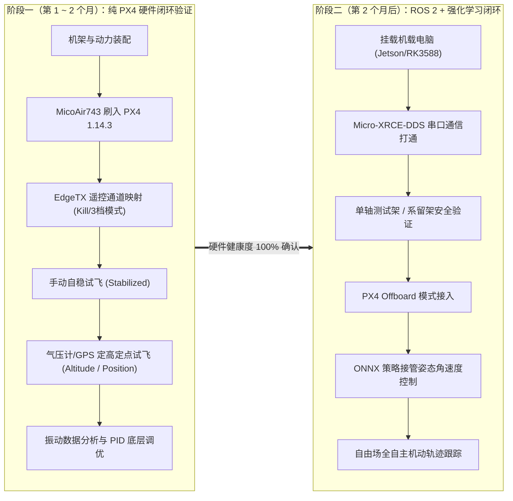

# 海雀27（Haique27）多旋翼强化学习自主控制系统 —— 项目全景规格与工程说明书

> **文档版本**: v1.0.0  
> **归属工程**: `Haique27_RL`  
> **更新时间**: 2026-10-31  
> **Git 远端**: `git@github.com:officialGitHubAdministrator/Haique27_RL.git`  
> **文档定位**: 本文档作为项目的权威规格总纲（Single Source of Truth），统揽系统架构、硬件参数、团队分工、控制接口规范与两阶段实施策略。开启新会话或新成员接入时，以此文档为最高准绳。

---

## 目录
- [一、 项目概述与核心愿景](#一-项目概述与核心愿景)
- [二、 两阶段演进路线图（安全第一原则）](#二-两阶段演进路线图安全第一原则)
- [三、 团队四组协同矩阵与交付物](#三-团队四组协同矩阵与交付物)
- [四、 分层控制架构与技术红线](#四-分层控制架构与技术红线)
- [五、 全栈软硬件系统基准线 (Baseline v1.0)](#五-全栈软硬件系统基准线-baseline-v10)
- [六、 实机硬件总成与动力学实测数据](#六-实机硬件总成与动力学实测数据)
- [七、 虚实通信契约与数据流定义](#七-虚实通信契约与数据流定义)
- [八、 强化学习任务设计与 Sim-to-Real 域随机化](#八-强化学习任务设计与-sim-to-real-域随机化)
- [九、 开发者环境与工程快速上手](#九-开发者环境与工程快速上手)

---

## 一、 项目概述与核心愿景

海雀27（Haique 27）是一套面向**高机动、强抗扰、复杂环境下多旋翼自主飞行控制**的具身智能软硬件全栈系统。
传统的 PID 级联控制器在高动态轨迹跟踪（如大角度机动、穿越狭窄门洞、瞬态突风扰动）下难以保持高精度追踪；本项目采用 **强化学习（Proximal Policy Optimization, PPO）**，在 NVIDIA Isaac Lab 超大规模并行物理仿真器中训练神经网络，再利用 ONNX Runtime 零衰减部署到物理无人机嵌入式边缘计算平台上，实现物理世界中的自主姿态稳定与轨迹跟踪。

---

## 二、 两阶段演进路线图（安全第一原则）

7 英寸四旋翼在 6S 动力加持下，整机推重比接近 **8:1**，四发总推力接近 10kg。在未经验证的算法直接控制实机时，极易造成严重炸机与人身安全风险。因此，全队必须严格遵守**两阶段推进策略**：



### 阶段一：纯 PX4 硬件与传统飞行验证（第 1 ~ 2 个月）
* **核心目标**：**不上机载电脑，不上 ROS 2，不跑神经网络**。
* **主要工作**：
  1. 完成 7 寸碳纤机架、F90 动力总成、60A 电调、MicoAir743 飞控的硬件组装与独立供电降压；
  2. 烧录 PX4 `v1.14.3` 官方固件，配置 DShot600 RPM 滤波；
  3. 使用 EdgeTX 遥控器完成手动自稳（Stabilized）、定高（Altitude）、定点（Position）基础试飞；
  4. 验证动力抗饱和、电调温度、整机结构共振及续航表现。

### 阶段二：机载系统接入与 RL 策略实机部署（第 2 个月后）
* **核心目标**：实现 **Isaac Lab 仿真策略 $\to$ ONNX 导出 $\to$ 机载电脑推理 $\to$ PX4 Offboard 模式自主飞行**。
* **主要工作**：
  1. 安装 Jetson Orin Nano / RK3588 伴随计算机，配置 ROS 2 Humble 与 Micro-XRCE-DDS Agent；
  2. 搭建单轴旋转台架与系留绳安全防炸保护；
  3. 遥控器映射 Offboard 模式，实现在空中由算法接管姿态与轨迹控制，出现异常时操作手一键无缝切回手动。

---

## 三、 团队四组协同矩阵与交付物

项目采用模块化职责矩阵，明确各技术节点责任人：

| 组别 | 核心职责 | 阶段一交付物 | 阶段二交付物 |
| :---: | :--- | :--- | :--- |
| **【机体组】** | 机身结构强度、气动布局、动平衡、减震与防炸工装设计 | 1. 7寸整机装配与动平衡<br>2. TPU 减震飞塔安装座<br>3. 动力电缆防磨走线 | 1. 单轴/双轴物理约束测试台架<br>2. 四角系留防坠缓冲系统<br>3. 机载电脑稳固安装支架 |
| **【电气组】** | 供电安全、电源隔离、电调通信、动力总成台架标定 | 1. 6S 转 5V/5A, 12V/5A 稳压模块<br>2. MT10PRO 测功台电机-桨叶推力标定曲线<br>3. DShot600 RPM 遥测接线 | 1. 机载电脑瞬态防掉电储能滤波电路<br>2. 实机电流/电压高频遥测回传<br>3. 电池低压报警与安全冗余 |
| **【航电组】** | 飞控固件适配、传感器校准、传统内环调试、机载中间件部署 | 1. MicoAir743 刷入 PX4 1.14.3<br>2. 传感器零偏校准与滤波器配置<br>3. EdgeTX 遥控急停与三档模式通道映射 | 1. Jetson/RK3588 ROS 2 节点<br>2. Micro-XRCE-DDS 50Hz 稳定收发<br>3. ONNX Runtime C++/Python 推理引擎<br>4. 故障快速切断 Failsafe 逻辑 |
| **【策略组】** | 仿真建模、PPO 策略训练、Sim-to-Real 域随机化、ONNX 模型固化 | 1. 基于真实测功曲线搭建 Isaac Lab 动力学模型<br>2. 完成悬停与轨迹跟踪 baseline PPO 策略训练 | 1. 加入 $20\sim 45\text{ms}$ 时延随机化的稳健策略<br>2. 导出符合 Opset 16 规范的 ONNX 模型<br>3. 仿真与实机飞行数据对比评估报告 |

---

## 四、 分层控制架构与技术红线

### 1. 架构拓扑
全系统严格执行 **“分层闭环”** 架构，严禁采用端到端直接输出 4 电机 PWM 的脆弱方案：

```
[ 上层：机载边缘计算平台 (Jetson Orin Nano / RK3588) ]
   └── 频率: 50Hz (20ms 周期)
   └── 运行: ROS 2 + ONNX Runtime (强化学习策略网络)
   └── 状态输入: 机体姿态四元数、机体系线速度、机体系角速度、目标位置与航向偏差
   └── 策略输出: 期望机体三轴角速度 [ωx, ωy, ωz] + 归一化总推力 τ_cmd ∈ [0, 1]
           │
           │ (UART1 @ 921600 bps / Micro-XRCE-DDS 传输 px4_msgs)
           ▼
[ 下层：开源飞控平台 (MicoAir743 + PX4 v1.14.3) ]
   └── 频率: 250Hz ~ 400Hz
   └── 运行: PX4 Offboard Rate Control Mode
   └── 功能: 传感器高频滤波、姿态角速度 PID 闭环、DShot600 动力混控分配
   └── 安全监管: 实时监控 EdgeTX 遥控器信号，紧急情况下抢夺最高控制权
           │
           ▼
[ 执行机构：60A 四合一电调 + 4× F90 1300KV 电机 ]
```

### 2. 技术红线（违反必炸机）
1. **控制指令格式**：策略网络严禁直接输出单个电机的 PWM/占空比。必须输出**期望机体三轴角速度 $\boldsymbol{\omega}_{cmd}$（rad/s）以及归一化总推力 $\tau_{cmd}$**。
2. **安全接管权**：任何时候，遥控器的物理优先级必须高于机载电脑。只要操作手拨动模式开关离开 Offboard，或打下急停开关（Kill Switch），飞控必须在 $\le 5\text{ms}$ 内切断算法指令并执行锁定。

---

## 五、 全栈软硬件系统基准线 (Baseline v1.0)

### 5.1 策略与仿真训练宿主机（Host Workstation）
* **操作系统**: Ubuntu 24.04 LTS (x86_64)
* **Python**: `Python 3.12.15`（通过 `uv` 严密锁定）
* **显卡与驱动**: NVIDIA RTX 5060 / 4090，Driver 595.x+
* **深度学习底座**: PyTorch `2.11.0+cu130`, NVIDIA Warp `1.17.0`
* **物理仿真底座**: NVIDIA Isaac Lab `v3.0.0` (基于 Omniverse Isaac Sim 6.2.0)
* **强化学习框架**: RSL-RL (PPO)

### 5.2 机载嵌入式平台与中间件
* **机载电脑**: NVIDIA Jetson Orin Nano (8GB) 或 迅为/香橙派 Orange Pi 5 (RK3588 8GB)
* **机载操作系统**: Ubuntu 22.04 LTS (aarch64)
* **机载 Python**: `Python 3.10.x`
* **通信中间件**: ROS 2 Humble Hawksbill
* **微通信代理**: Micro-XRCE-DDS-Agent `v2.4.1`
* **消息定义**: `px4_msgs` (`release/1.14` 分支)
* **模型推理引擎**: ONNX Runtime (GPU/TensorRT) `1.17.x`

### 5.3 飞控与遥控安全链路
* **主控硬件**: MicoAir743 v1.3 (MCU: STM32H743VIT6 @ 480MHz, IMU: BMI088, 气压计: SPL06)
* **飞控固件**: PX4 Autopilot `v1.14.3` 稳定发行版
* **遥控发射机**: RadioMaster TX12 MKII (或 Pocket)，运行 **EdgeTX 2.9+** 系统
* **高频协议**: ExpressLRS (ELRS 2.4G) v3.3+，封包率 250Hz，协议 CRSF

---

## 六、 实机硬件总成与动力学实测数据

### 6.1 关键硬件选型明细表

| 类别 | 选用型号 / 规格 | 核心优势 / 说明 |
| :--- | :--- | :--- |
| **机架** | GEPRC GEP-Mark4 7寸碳纤机架 (轴距 295mm) | 臂厚 5mm，刚性极佳，中板空间宽敞，利于堆叠机载电脑 |
| **电机** | T-Motor F90 1300KV 或 2807 1300KV 无刷电机 | 大定子磁钢，扭矩强劲，散热优秀，适配 6S 7寸桨 |
| **桨叶** | HQProp 70403 (7×4×3) 或 Gemfan 7042 3叶高强PC桨 | 高效率低共振，在 1300KV 下推力线性平顺 |
| **电调** | 55A ~ 60A 四合一 BLHeli_32 / AM32 电调 | 支持 DShot600，支持双向 DShot 实时回传电机转速 (RPM) |
| **飞控** | **MicoAir743 v1.3** | 原生运行 PX4 1.14.3，体积 30.5×30.5mm，性能对标 Pixhawk 6C |
| **卫星定位** | Holybro / MicoAir M9N GPS + 磁罗盘模块 | 支持 GPS+北斗+Galileo，高刷新率 |
| **动力电池** | 6S 22.2V 3300mAh ~ 4000mAh 100C 高倍率锂聚合物电池 | 满足 60A 瞬时脉冲放电，续航约 8~12 分钟 |
| **供电稳压** | 6S 宽压转 5V/5A (飞控) + 12V/5A (Jetson) 独立 DC-DC 模块 | 高品质磁屏蔽电感，防电机反电动势浪涌 |

### 6.2 动力学实测拟合参数 (MT10PRO 测功台数据)

基于真实台架测得的单发数据（HQ 70403 桨 + F90 1300KV 电机 @ 24V 6S 满电）：
* **单发最大推力**: $2360\text{g}$（油门 100%）
* **四发全机最大推力**: $9440\text{g}$ ($\approx 92.5\text{N}$)
* **估算全机全备起飞重量 (AUW)**: $1200\text{g}$（含电池、机载电脑及机体）
* **整机推重比 (TWR)**: **$7.87 : 1$**
* **全机悬停油门 (Hover Throttle)**: **$28.2\%$**
* **推力-油门拟合函数**:
  $$\text{Thrust}(u) = c_2 \cdot u^2 + c_1 \cdot u + c_0$$
  其中归一化油门 $u \in [0, 1]$，单发推力单位（牛顿 N）：
  * $c_2 = 14.28$, $c_1 = 8.84$, $c_0 = 0.0$ ($R^2 = 0.9957$)

> **注意**：因推重比极高，仿真中必须限制初始探索动作幅度，否则直立测试时无人机将瞬间超速弹射。

---

## 七、 虚实通信契约与数据流定义

### 1. 坐标系与数学定义
* **ROS 2 / 机载平台**: **FLU（前-左-上，Forward-Left-Up）**。
* **PX4 飞控内部**: **FRD（前-右-下，Forward-Right-Down）**。
* **坐标转换规则**:
  $$\boldsymbol{\omega}_{FRD} = [\omega_x, -\omega_y, -\omega_z]_{FLU}^T$$
* **四元数标准**: 跨模块网络传输中，四元数实部必须统一在首位：**`[w, x, y, z]`**。

### 2. ROS 2 通信主题定义（50Hz 周期）
* **策略下发控制主题**:
  * Topic: `/fmu/in/vehicle_rates_setpoint`
  * Message: `px4_msgs/msg/VehicleRatesSetpoint`
  * 字段映射:
    * `roll`: $\omega_{x, FRD}$ (rad/s)
    * `pitch`: $\omega_{y, FRD}$ (rad/s)
    * `yaw`: $\omega_{z, FRD}$ (rad/s)
    * `thrust_body`: `[0.0, 0.0, -τ_cmd]` (PX4 FRD 体系下推力向上对应负 Z 轴，$\tau_{cmd} \in [0, 1]$)
* **状态反馈主题**:
  * Topic: `/fmu/out/vehicle_odometry`
  * Message: `px4_msgs/msg/VehicleOdometry`
  * 提取: 当前机体四元数姿态、机体系角速度、机体系线速度。

### 3. 模型导出契约
* 导出的策略模型格式：**ONNX**。
* ONNX 导出参数必须显式声明：`opset_version = 16`。
* 观察输入向量包含：
  1. 当前机体四元数 $\mathbf{q} \in \mathbb{R}^4$；
  2. 当前机体系线速度 $\mathbf{v}_{body} \in \mathbb{R}^3$；
  3. 当前机体系角速度 $\boldsymbol{\omega}_{body} \in \mathbb{R}^3$；
  4. 目标相对位置偏差 $\Delta \mathbf{p}_{body} \in \mathbb{R}^3$；
  5. 上一时刻执行动作历史 $\mathbf{a}_{t-1} \in \mathbb{R}^4$。

---

## 八、 强化学习任务设计与 Sim-to-Real 域随机化

为保证在 Isaac Lab 中训练出的神经网络能够成功迁移（Sim-to-Real），必须在强化学习的 MDP 环境中加入全面的物理域随机化（Domain Randomization）：

| 随机化物理参数 | 名义值 (Nominal) | 随机化范围 (Random Range) | 物理意义 |
| :--- | :--- | :--- | :--- |
| **机体总质量 ($m$)** | $1.20\text{ kg}$ | $[1.05, 1.35]\text{ kg}$ ($\pm 12.5\%$) | 覆盖不同容量电池及机载配件重量差异 |
| **转动惯量 ($I_{xx}, I_{yy}, I_{zz}$)** | 标称计算值 | $[0.8, 1.25] \times \mathbf{I}_{nominal}$ | 覆盖布线、载重位置不同导致的转动惯量偏移 |
| **电机推力系数 ($C_T$)** | $23.15\text{ N}$ | $[0.85, 1.15] \times C_T$ | 模拟电池电压衰减（25.2V $\to$ 21.6V）与桨叶气动差异 |
| **质心偏移 ($\Delta \mathbf{r}_{CoM}$)** | $[0, 0, 0]\text{ m}$ | $[-0.015, 0.015]\text{ m}$ (X/Y 轴) | 模拟电池安装偏心引起的静态偏置力矩 |
| **系统控制动作时延 ($\tau_{delay}$)** | $20\text{ ms}$ | **$[20, 45]\text{ ms}$（队列缓存随机采样）** | **最关键项**：覆盖 ROS 2 调度、DDS 传输与飞控内环时延 |

---

## 九、 开发者环境与工程快速上手

### 1. 激活开发环境
宿主机使用 `uv` 管理虚拟环境：
```bash
cd /home/wang/Haique27_RL

# 激活 uv 托管的 Python 3.12 虚拟环境
source /home/wang/IsaacLab/.venv/bin/activate

# 确认当前环境包信息
uv pip list
```

### 2. 代码组织与工作区规范
本项目核心算法源码均置于 `src/haique27_rl/` 目录：
* `src/haique27_rl/envs/`: Isaac Lab 多旋翼环境与奖励函数配置；
* `src/haique27_rl/models/`: PPO Actor-Critic 策略与 ONNX 转换管线；
* `src/haique27_rl/utils/`: FLU $\leftrightarrow$ FRD 坐标转换、四元数规范化数学库。

### 3. Git 协同工作流
* 主分支 `main` 受保护，只允许合并验证通过的代码；
* 每次提交前，必须确保代码经过格式化，且不包含超过 10MB 的大型权重文件或二进制日志。
